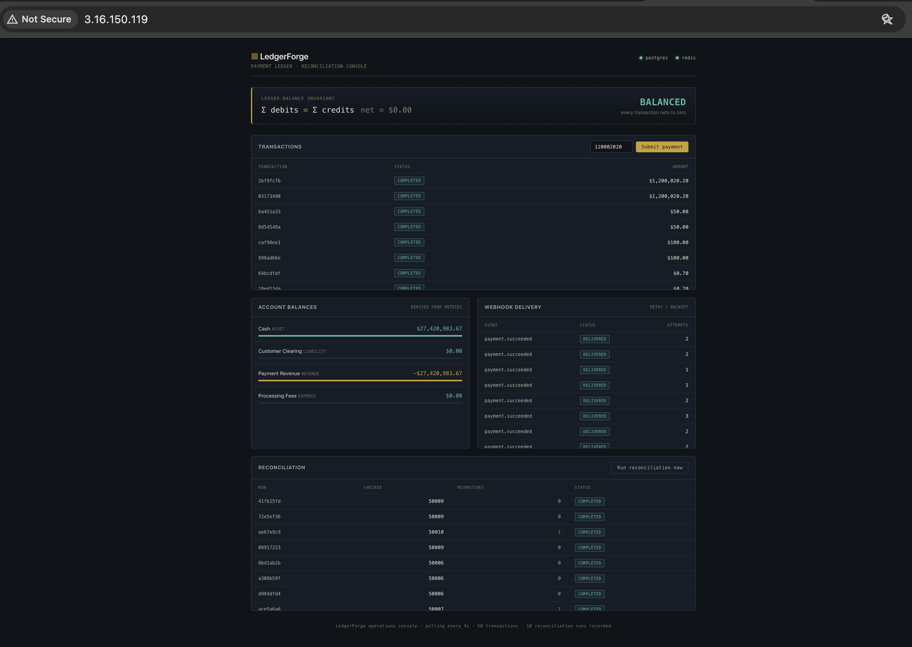

# LedgerForge

**A cloud payment ledger & reconciliation platform** — double-entry accounting with a database-enforced balance invariant, idempotent payments, and independent reconciliation.

**[▶ Watch the demo](https://youtu.be/Wmw6I7dmefs)** — the balance invariant flips to IMBALANCE the instant the ledger is corrupted, then back to BALANCED.

## What it is

LedgerForge records money movements using double-entry bookkeeping and guarantees the books always balance — even under duplicate requests, failed webhooks, or out-of-band corruption. Balances are *derived* from ledger entries, never stored, so they can't drift from history.

## Highlights

- **Double-entry ledger** with a deferred Postgres constraint trigger enforcing that every transaction's entries sum to zero — at the database layer, so it can't be bypassed.
- **Idempotent payments** — Redis SET NX fast path backed by a Postgres unique constraint. Load-tested at 700K+ colliding requests with zero duplicate charges.
- **Async webhook delivery** with exponential backoff and a dead-letter state.
- **Independent reconciliation engine** that sweeps for imbalances and status mismatches; verified clean across 1M+ transactions.
- **p95 ~9.6ms** write latency, ~2,300 payments/sec, 0% errors under load.

## Stack

TypeScript · NestJS · PostgreSQL · Redis · Next.js · Docker · k6 · AWS EC2

## Run it

    docker compose -f docker-compose.prod.yml up -d --build

Dashboard at http://localhost . See DEPLOY.md for the AWS walkthrough and BENCHMARKS.md for load-test details.
